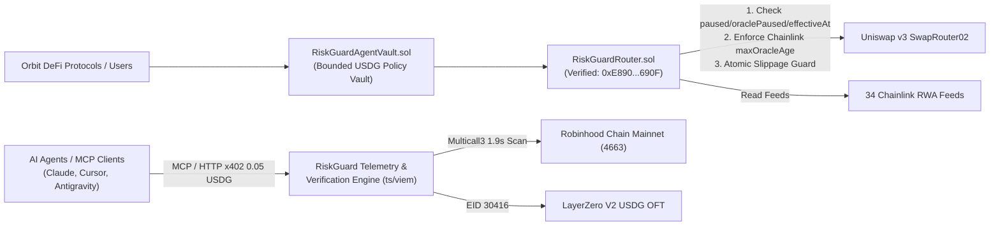

# RiskGuard RWA

> **On-Chain ERC-8056 Oracle Safety Layer, Atomic Circuit-Breaker Router, Bounded Agent Vault & MCP/x402 Guardrail Infrastructure for [Robinhood Chain](https://docs.robinhood.com/chain/) (`chainId: 4663`, LayerZero `EID: 30416`).**

[](https://robinhoodchain.blockscout.com/)
[](https://robinhoodchain.blockscout.com/address/0xE890D81346C465fAE5bCa38ad825669dE448690F)
[](#architecture)

---

## Why RiskGuard RWA Exists

Robinhood Chain already hosts **$137M+ in tokenized equity supply** and **$23M+ in Uniswap v3 liquidity** across **95 Stock Tokens** implemented with **ERC-8056** (`uiMultiplier()` scaling). While tokenized equities unlock 24/7 composable DeFi, they break standard ERC-20 assumptions in two critical ways:

1. **The ERC-8056 `uiMultiplier()` Double-Counting Hazard (+100% to +200% Valuation Errors):**
   Corporate actions (stock splits and reinvested dividends) shift each token's on-chain `uiMultiplier()` over time. On Robinhood Chain mainnet today, **30 of 95 Stock Tokens** already have `uiMultiplier != 1.0x` (for example, `SOXX` at `3.001353x` and `WEEK` at `2.006183x`). Because Robinhood Chain's Chainlink feeds already output **multiplier-adjusted per-token USD prices**, any lending protocol, vault, or AI agent that naively computes `feedPrice * uiMultiplier` overvalues collateral by **2x–3x**.
2. **24/7 Permissionless AMMs vs. 24/5 Equity Oracles:**
   Uniswap v3 Stock Token pools trade continuously around the clock, while underlying Chainlink feeds pause during weekends (~`72h`), overnight market closures, or corporate action windows (`oraclePaused() == true` / pending `effectiveAt()`). Unguarded swaps or liquidations inside those windows suffer severe AMM-vs-oracle divergence.

*Note on Robinhood Agentic Accounts / Agents:* Robinhood's native **Agentic Accounts / Robinhood Agents** protect users *inside custodial brokerage accounts*. **RiskGuard RWA** secures the **non-custodial, permissionless on-chain DeFi layer** on Robinhood Chain (`4663`) once Stock Tokens are held in self-custody wallets, AMMs, lending markets, or smart vaults.

---

## Architecture



---

## Verified Mainnet Contracts & Canonical Addresses (`chainId: 4663`)

| Component | Mainnet Address | Verification / Role |
|---|---|---|
| **`RiskGuardRouter` (Ours — Verified)** | [`0xE890D81346C465fAE5bCa38ad825669dE448690F`](https://robinhoodchain.blockscout.com/address/0xE890D81346C465fAE5bCa38ad825669dE448690F) | Stateless atomic Uniswap v3 circuit-breaker router (`foundry-lab/src/RiskGuardRouter.sol`) |
| **`RiskGuardAgentVault` (Fork-Tested)** | `foundry-lab/src/RiskGuardAgentVault.sol` | Non-custodial `USDG` policy vault enforcing per-trade & 24h agent limits |
| **`USDG` (6 decimals)** | [`0x5fc5360D0400a0Fd4f2af552ADD042D716F1d168`](https://robinhoodchain.blockscout.com/address/0x5fc5360D0400a0Fd4f2af552ADD042D716F1d168) | Primary settlement quote token & `x402` verification fee asset |
| **`WETH`** | [`0x0Bd7D308f8E1639FAb988df18A8011f41EAcAD73`](https://robinhoodchain.blockscout.com/address/0x0Bd7D308f8E1639FAb988df18A8011f41EAcAD73) | Secondary DEX quote token |
| **`StockTokenBeacon`** | [`0xe10b6f6B275de231345c20D14Ab812db62151b00`](https://robinhoodchain.blockscout.com/address/0xe10b6f6B275de231345c20D14Ab812db62151b00) | Shared ERC-8056 beacon (`uiMultiplier()`, `oraclePaused()`, `effectiveAt()`) |
| **`StockFactory` (Proxy)** | [`0x4783C67b63dE2B358Ac5951a7D41F47A38F3C046`](https://robinhoodchain.blockscout.com/address/0x4783C67b63dE2B358Ac5951a7D41F47A38F3C046) | Canonical Stock Token registry factory (95 Stock Tokens) |
| **Uniswap v3 `SwapRouter02` / `QuoterV2`** | [`0xCaf681a6...9E5cb2`](https://robinhoodchain.blockscout.com/address/0xCaf681a66D020601342297493863E78C959E5cb2) / [`0x33e885eD...b4c8A9E7`](https://robinhoodchain.blockscout.com/address/0x33e885eD0Ec9bF04EcfB19341582aADCb4c8A9E7) | On-chain DEX routing and executable quote probing |
| **LayerZero V2 `EndpointV2` (`EID 30416`)** | [`0x6F475642a6e85809B1c36Fa62763669b1b48DD5B`](https://robinhoodchain.blockscout.com/address/0x6F475642a6e85809B1c36Fa62763669b1b48DD5B) | Omnichain `USDG` OFT corridor monitoring |

---

## Live Mainnet Telemetry Benchmark

Our 24/7 telemetry node continuously benchmarks Robinhood Chain Mainnet (`4663`), logged directly in [`data/paper_ledger.json`](data/paper_ledger.json):

* **5,726+ full mainnet `Multicall3` scans** across 95 Stock Tokens, 34 Chainlink feeds, and 760 Uniswap v3 pool candidates (~`1.9s` per full scan).
* **40 block-verified AMM-to-Chainlink dislocation convergence cycles** (`16` discount convergences + `24` premium convergences across `USAR`, `NVDA`, `SPCX`, `AAPL`, `CRCL`, `COIN`, `BABA`) captured with explicit direction, block range, pool fee tier, and L2 gas accounting.
* **`x402` Pay-Per-Verification API** (`GET /api/x402/execute-payload`) verifying `0.05 USDG` on-chain settlement on `4663` before serving oracle-guarded `RiskGuardRouter` execution calldata.

---

## Repository Layout

* [`foundry-lab/`](foundry-lab/) — Solidity smart contracts (`RiskGuardRouter.sol`, `RiskGuardAgentVault.sol`), deployment scripts, verification JSON, and Foundry mainnet-fork tests.
* [`rh-rwa-agent/`](rh-rwa-agent/) — TypeScript / `viem` core engine:
  * `src/scanner.ts` — sub-2s `Multicall3` Stock Token, Chainlink, `uiMultiplier()`, and Uniswap v3 scanner.
  * `src/paper-trader.ts` — RWA dislocation & corporate-action telemetry benchmark tracker.
  * `src/ecosystem.ts` — LayerZero V2 `USDG` OFT corridor & wallet readiness inspector.
  * `src/x402.ts` — HTTP `402 Payment Required` on-chain `USDG` verifier & `RiskGuardRouter` calldata encoder.
  * `src/dashboard.ts` — Web telemetry terminal & `x402` sandbox UI (`PORT=3847`).
  * `src/mcp-server.ts` — Model Context Protocol (MCP) server for AI agent frameworks.
  * `src/telegram-bot.ts` — Real-time Telegram telemetry & alert terminal (`@RiskGuardTerminal_Bot`).
* [`contracts/`](contracts/) & [`data/stock-tokens.json`](data/stock-tokens.json) — Verified Stock Token beacon Solidity sources and canonical 95-token JSON registry.
* [`docs/ARBITRUM_GRANT_PROPOSAL.md`](docs/ARBITRUM_GRANT_PROPOSAL.md) — Institutional architecture roadmap, milestones, and ecosystem integration proposal (v2.0).

---

## Quickstart

### 1. Run Foundry Fork Tests (`foundry-lab`)

```bash
cd foundry-lab
forge test --fork-url https://rpc.mainnet.chain.robinhood.com -vvv
```

### 2. Run the Telemetry Scanner, Dashboard & MCP Server (`rh-rwa-agent`)

```bash
cd rh-rwa-agent
npm install
cp .env.example .env

# Run one full mainnet Multicall3 scan (95 Stock Tokens, 34 Chainlink feeds, Uniswap v3 pools)
npm run scan

# Inspect LayerZero V2 USDG OFT corridors & gas/ecosystem telemetry
npm run ecosystem

# Build TypeScript & launch the Web Terminal + x402 endpoint (http://localhost:3847)
npm run build
npm run dashboard

# Launch the MCP stdio server for AI agents (Claude, Cursor, Antigravity)
npm run mcp
```

---

## Regulatory & Non-Custodial Scope

`RiskGuardRouter.sol` is strictly a **stateless, non-custodial on-chain safety wrapper**: it holds zero user deposits between transactions, issues no securities, and provides no investment advice or financial recommendations. All `x402`, MCP, dashboard, and Telegram outputs provide oracle health verification and execution-guardrail telemetry only. Canonical Stock Tokens (issued by Robinhood Assets (Jersey) Ltd) are tokenized debt securities restricted for **US, UK, Canadian, and Swiss persons**; operators must enforce front-end/API jurisdictional eligibility rules accordingly.
